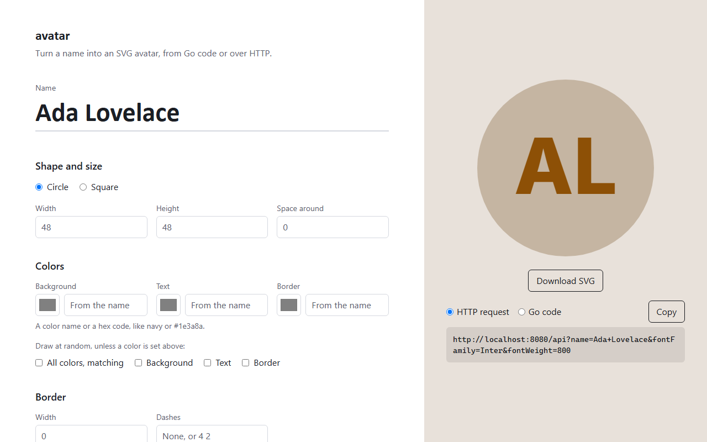
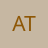

# avatar

[](https://pkg.go.dev/github.com/go-mods/avatar)
[](https://go.dev/)
[](LICENSE)

avatar turns a name into an SVG avatar: a shape, a color which comes from the name, and its initials.
Use it as a Go library, or run its HTTP server, which also has a page to try every option live.

<picture>
<source media="(prefers-color-scheme: dark)" srcset="docs/examples/page-dark.png">

</picture>

<details>
<summary>Table of contents</summary>

- [Use the library](#use-the-library)
- [Examples](#examples)
- [Run the server](#run-the-server)
- [Fonts](#fonts)
- [Development](#development)
- [License](#license)

</details>

## Use the library

The library needs Go 1.26 or later.

```bash
go get github.com/go-mods/avatar
```

`GetSVG` takes the text to draw. [go-mods/initials](https://github.com/go-mods/initials) computes it from a name:

```go
package main

import (
    "fmt"
    "log"

    "github.com/go-mods/avatar"
    "github.com/go-mods/initials"
)

func main() {
    svg, err := avatar.GetSVG(initials.GetInitials("Ada Lovelace"),
        avatar.WithShape("square"),
        avatar.WithWidth(96),
        avatar.WithHeight(96),
        avatar.WithBorderRadius(12),
    )
    if err != nil {
        log.Fatal(err)
    }
    fmt.Print(svg)
}
```

### Options

| Option | Effect | Default |
| --- | --- | --- |
| `WithWidth(n)`, `WithHeight(n)` | Size of the image | 48 |
| `WithShape(s)` | `"circle"` or `"square"` | `"circle"` |
| `WithPadding(n)` | Space around the shape | 0 |
| `WithBackgroundColor(c)`, `WithFontColor(c)`, `WithBorderColor(c)` | A color name or a hex code | From the initials |
| `WithBackgroundColorFunc(f)`, `WithFontColorFunc(f)`, `WithBorderColorFunc(f)` | A function which generates the color | Built-in palette |
| `WithRandomColor()` | Draw all the colors at each call, matching each other | Off |
| `WithRandomBackgroundColor()`, `WithRandomFontColor()`, `WithRandomBorderColor()` | Draw one color at each call | Off |
| `WithFont(family, weight)` | A Google Fonts family and a weight; an empty family keeps the system font | System font, 400 |
| `WithFontSize(n)` | Size of the text | From the image |
| `WithFontDir(dir)` | Where the fonts are kept | Temporary directory |
| `WithBorderWidth(n)` | Width of the border | 0 |
| `WithBorderDash(s)` | `"none"` or a list of numbers, like `"4 2"` | `"none"` |
| `WithBorderRadius(n)` | Corner radius of a square | 0 |

A color set explicitly always wins over a random color and a color function. The same initials give the same colors,
unless a random option is on.

`GetSVGContext` does the same as `GetSVG` with a context, which stops the download of a font.

### Errors

An invalid option returns an error to test with `errors.Is`: `ErrInvalidSize`, `ErrInvalidColor`, `ErrInvalidShape`,
`ErrInvalidBorderDash`, `ErrInvalidFontFamily` or `ErrInvalidFontWeight`. `ErrUnknownFont` means that Google Fonts holds
neither this family nor this weight.

## Examples

Each image is the answer of the server to this request, kept by `task readme:capture`.

<!-- examples:start -->

| Avatar | What it shows | Request | Go options |
| --- | --- | --- | --- |
|  | Colors from the name | `/api?name=Grace+Hopper` | No option |
|  | Square | `/api?name=Alan+Turing&shape=square` | `avatar.WithShape("square")` |
|  | Rounded corners | `/api?name=Ada+Lovelace&shape=square&borderRadius=12` | `avatar.WithShape("square"), avatar.WithBorderRadius(12)` |
|  | Border | `/api?name=Linus+Torvalds&borderWidth=3&borderColor=steelblue` | `avatar.WithBorderWidth(3), avatar.WithBorderColor("steelblue")` |
|  | Dashed border | `/api?name=Radia+Perlman&borderWidth=2&borderDash=4+2&borderColor=darkslategray` | `avatar.WithBorderWidth(2), avatar.WithBorderColor("darkslategray"), avatar.WithBorderDash("4 2")` |
|  | Your own colors | `/api?name=Katherine+Johnson&backgroundColor=midnightblue&fontColor=gold` | `avatar.WithBackgroundColor("midnightblue"), avatar.WithFontColor("gold")` |
|  | Space around | `/api?name=Hedy+Lamarr&padding=6&backgroundColor=%23fde68a` | `avatar.WithBackgroundColor("#fde68a"), avatar.WithPadding(6)` |
|  | Wide canvas | `/api?name=Ken+Thompson&width=96&height=48` | `avatar.WithWidth(96), avatar.WithHeight(48)` |
|  | A Google font | `/api?name=Margaret+Hamilton&fontFamily=Pacifico` | `avatar.WithFont("Pacifico", 400)` |
|  | A heavy weight | `/api?name=Barbara+Liskov&fontFamily=Inter&fontWeight=900` | `avatar.WithFont("Inter", 900)` |
|  | Three letters | `/api?name=Dennis+Ritchie&length=3&fontSize=16` | `initials.WithLength(3), avatar.WithFontSize(16)` |
|  | Separated initials | `/api?name=Edsger+Dijkstra&separator=.&fontSize=16` | `initials.WithSeparator("."), avatar.WithFontSize(16)` |

<!-- examples:end -->

## Run the server

With Docker, from a clone of this repository, on <http://localhost:8080>:

```bash
docker compose up -d
```

Or with Go:

```bash
go run ./cmd/avatar
```

| Route | Answer |
| --- | --- |
| `GET /` | The page to try the options live |
| `GET /api` | The avatar described by the parameters below |
| `GET /health` | `{"status":"ok"}` |

| Command line | Effect | Default |
| --- | --- | --- |
| `-addr` | Address to listen on | `:8080` |
| `-fontdir` | Where the fonts are kept | Temporary directory |
| `avatar healthcheck` | Asks a running server for its health, and fails if it does not answer | |

The Docker image has no shell: use `docker compose logs` and `/health` to look into a running server. `AVATAR_PORT`
changes the published port, and the fonts are kept in a named volume.

### Parameters of `/api`

| Parameter | Type | Values | Default |
| --- | --- | --- | --- |
| `name` | text | At most 256 characters | Empty |
| `separator` | text | Between the initials | None |
| `length` | number | 1 to 64: letters of the initials | 2 |
| `lowercase`, `uppercase`, `camelcase` | boolean | Case of the initials | Upper case |
| `sensitive` | boolean | Keep the case of the name | `false` |
| `wordLength` | boolean | One letter per word | `false` |
| `width`, `height` | number | 1 to 4096 | 48 |
| `shape` | text | `circle`, `square` | `circle` |
| `padding` | number | 0 to 4096 | 0 |
| `backgroundColor`, `fontColor`, `borderColor` | text | A color name or a hex code, with `#` encoded as `%23` | From the name |
| `randomColor`, `randomBackgroundColor`, `randomFontColor`, `randomBorderColor` | boolean | Draw the colors at each request | `false` |
| `fontFamily` | text | A Google Fonts family | System font |
| `fontWeight` | number | 1 to 1000 | 400 |
| `fontSize` | number | 1 to 4096 | From the image |
| `borderWidth`, `borderRadius` | number | 0 to 4096 | 0 |
| `borderDash` | text | `none` or a list of numbers | `none` |

A boolean is `true` or `false`, `1` or `0`. An invalid value gets a `400` answer which names it:
`{"error":"invalid parameter width: \"abc\""}`.

An avatar can be cached for a day, unless a random option is on.

## Fonts

`WithFont` and `fontFamily` download the font from Google Fonts, reduced to the letters of the initials, and embed it in
the SVG. The avatar then displays its font even as an image, where a browser loads nothing from outside: "JD" in Inter 900
takes about 3 KB. Each family, weight and initials is downloaded once, then kept in the font directory.

The avatar stays usable without its font, which is replaced by the system sans-serif when:

- the font servers cannot be reached, and the download is tried again at the next call;
- the font holds none of the letters, as with Chinese initials and Inter.

GitHub forbids fonts in the images of a repository, so the examples above which use a font are shown as PNG.

## Development

Prerequisites: Go 1.26, [Task](https://taskfile.dev/installation/), and Node 24 to change the page.

```bash
task go-tools:install   # Install the pinned Go tools
task go:default         # Format, check, lint and test
task go:vuln            # Look for known vulnerabilities
task go:test-race       # Test with the race detector (needs a C compiler)
```

The page lives in `cmd/avatar/web` (Vue, TypeScript, Tailwind CSS). Its built files are versioned and embedded in the
server, which therefore builds without Node. After changing the page, commit its sources and the result of the build.

```bash
task web:install        # Install the dependencies
task web:dev            # Serve the page with live reload; the Go server answers /api
task web:test           # Test the page
task web:build          # Check the types and build the page
task web:check          # Fail if the built page differs from its sources
```

```bash
task docker:build       # Build the image
task docker:up          # Start the server and wait until it is healthy
task docker:logs        # Follow the logs
task docker:down        # Stop the server, the fonts are kept
task docker:clean       # Stop the server and remove the fonts and the image
```

To add an example to this page, add it to `docs/examples/examples.json`, then run `task readme:capture`.

## License

MIT, see [LICENSE](LICENSE).
